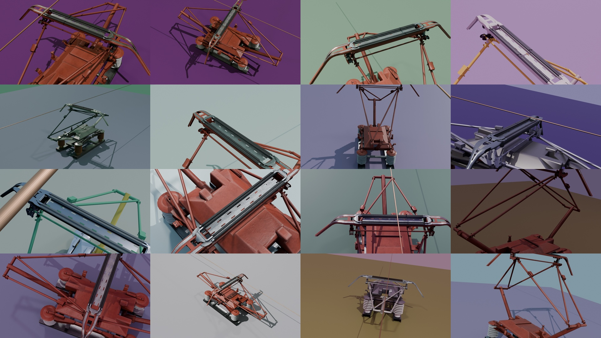
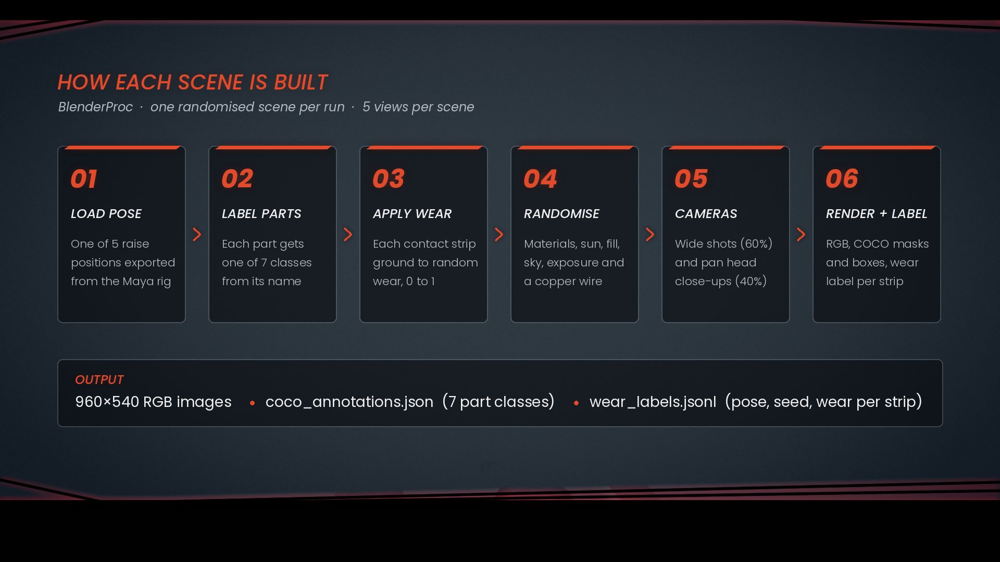

# Synthetic Dataset for Railway Pantograph Inspection

Labelled synthetic images of a railway pantograph for part detection and contact strip wear estimation, generated with BlenderProc from a rigged real-time asset rebuilt from engineering CAD.

## What it produces
- 400 RGB images from 80 randomised scenes (960×540)
- COCO instance segmentation masks and bounding boxes, 7 part classes
- `wear_labels.jsonl`: pose, texture mode, seed and per-strip wear (0–1) for every image

| ID | Class | Parts |
|---|---|---|
| 1 | contact_strip | The 4 carbon contact strips |
| 2 | pan_head | Head frame, horns, strip clamps, apex bearings |
| 3 | head_suspension | Suspension bodies, levers, saddles, springs |
| 4 | upper_frame | Upper arms, frame legs, knees, fittings, apex tubes |
| 5 | lower_frame | Lower arms, sleeves, main shafts |
| 6 | insulator | The 4 support insulators |
| 7 | base | Base frame, caps, rails, rest stops, brackets |

## How each scene is built

1. Load one of 5 raise positions exported from the Maya rig
2. Label every part from its name
3. Grind each contact strip to a random wear between 0 and 1
4. Randomise materials (Painter textures in half the scenes), sun, fill light, sky and exposure
5. Add a copper contact wire as a distractor
6. Render wide shots and head close-ups, append to the COCO dataset

## Run it
pip install blenderproc
blenderproc run dataset/dataset.py <poses_dir> output --textures <textures_dir> --views 5 --seed 1

## Repository
- `dataset/`: dataset generator and portfolio image script
- `maya_tools/`: Maya Python tools used to build and rig the asset
- `freecad/`: CAD export macro
- `sample_data/`: 20-image sample with annotations

## Credits
Asset rebuilt from the CAD model "Pantograph L-1U1-01" by Igor Lavrukhin (GrabCAD). The CAD-derived meshes are not included. Rendering by BlenderProc.
